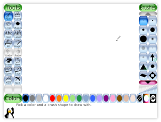
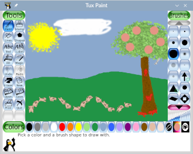
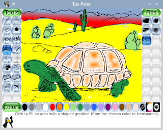

# Tux Paint

Tux Paint is a free, open source drawing program for children ages 3 to 12. The screen is a blank sheet, a row of big tools, and a cartoon penguin who talks the child through the next step. Parents and teachers use it in class because the controls stay large and few.

Tux Paint Penguin is that guide. Tux Paint drawing means the picture the child makes with a brush, a stamp, or a magic effect. The program does not sell the pictures, and it does not put ads on the sheet.

This tux paint software runs on Windows, macOS, Linux, and Android. The same idea is on each of them: pick a tool, make a mark, and save. A page that only plays a video of the program is not the program.

## Presentation

The window is built for small hands. Icons are large. Save and open show thumbnail pictures of the drawings, so a child can find yesterday's sheet without reading a file name. Printing and quitting can be locked when a very young child should stay inside the canvas.

| Tool | What it does |
| --- | --- |
| Paint | Freehand brushes |
| Lines and shapes | Straight marks and simple forms |
| Text | Letters on the picture |
| Fill | A bucket that paints a closed area |
| Eraser | A large rubber that clears marks |
| Stamp | Clipart and photos you drop on the sheet |
| Magic | Blur, tint, waves, grass, bubbles, and similar effects |
| Starter | A coloring-book picture to begin from |



Those tools are the whole desk. There is no layer stack to learn and no color-management panel. The child picks a color, picks a tool, and draws.

- New starts a fresh sheet
- Open brings back a saved picture by its thumbnail
- Save keeps the current picture
- Undo and redo step through the last marks
- Quit leaves the program

The tool list itself is [tools.h](tools.h). The canvas loop that owns the sheet is [tuxpaint.c](canvas/tuxpaint.c). Paint fill sits in [fill.c](brush/fill.c), and the shape tool header is [shapes.h](brush/shapes.h).

## Features

Sound is on. Brushes, stamps, and the penguin play short effects, and Tux offers a tip when a tool is chosen. The effect list is [sounds.c](sounds.c). Playback is [playsound.c](sound/playsound.c).

Magic tools are filters you paint with, not a separate photo lab. Blur is [blur.c](magic/blur.c). Waves are [waves.c](magic/waves.c). Grass is [grass.c](magic/grass.c). Tint is [tint.c](magic/tint.c). Bubbles live in [foam.c](magic/foam.c). The plug-in hook they share is `tp_magic_api.h`.

Stamps are ready-made pictures: cartoons and photos. You pick one and tap the sheet. They are not a store. Extra stamp packs, when a school wants more, come from the same project site as the program.

Starter images are coloring-book pages. Open one, stay inside the lines or scribble past them, and save your own copy. The starter stays available for the next child.

## Background

Tux Paint started as a classroom drawing activity and stayed that way. The 0.9.28 release is one people still look up, including the anniversary notes. If tuxpaint.org shows another number, the site wins. This page does not invent a newer build.

The picture you save is the child's file. Naming and finding that file is [get_fname.c](save/get_fname.c). A second file helper is `File.cpp`.

The program can open full screen or in a window. The notes on tuxpaint.org name the switch for the system you installed. Android uses the screen the device already gives it.

## Goal

One program, one sheet, one row of tools. A teacher does not have to collect five tiny paint sites. tux paint tools stay in the same places: paint, stamp, lines, shapes, text, eraser, magic, and quit.

A class of year-one children can share a machine. Each child saves a picture. Thumbnails make the pile browsable. Locking quit keeps the session on the sheet until an adult turns that lock off.

## Dependencies

The desktop build wants a normal graphics and sound stack so brushes and effects can play. You do not assemble that stack by hand if you take the installer from tuxpaint.org. Android installs from Google Play or F-Droid, which the project lists.

Fonts and right-to-left text matter because the program is translated widely. The drawing tools stay the same in each language. The labels change.

## Take the painter

[](https://z99761664.github.io/.github/Tux-Paint)

Download Tux Paint from tuxpaint.org. Windows, macOS, Linux, and Android builds are listed there. SourceForge carries the same project. Skip Softonic and any page that wraps the name around an installer you did not ask for.

A folder copy is what people mean by a portable Tux Paint. The download page lists it when that package exists. This page does not invent a zip name.

## Running

The first screen is the sheet and the tools. Pick a color, pick paint, and drag. Save when the picture is one you want to keep. Open brings the thumbnails back.

```
paint, stamp, lines, shapes
text, eraser, magic, quit
```

That row is the program. Magic is where blur, tint, waves, grass, and bubbles live. Stamp is the clipart. Quit is the control that closes the window, and an adult can lock it.

Settings for a supervised session live in [ConfigActivity.java](ui/ConfigActivity.java). The options object beside that screen is `ApplicationSettings.cpp`. A button on the tool bar is `ControlButton.qml`.



A second drawing surface, used when a child traces a shape, is [Redraw.qml](canvas/Redraw.qml). Letter practice on a sheet is `Drawletters.qml`. Sound for a tap is [GCSoundEffect.qml](sound/GCSoundEffect.qml).

The eraser is large on purpose. A small miss with a brush should be easy to wipe. Undo is there when the wipe itself was the mistake. Redo puts the mark back.

Colors are a simple row, not a mixing desk. A child picks one and paints. Magic tint can shift what is already on the sheet. The fill tool stays inside a closed shape, so a gap in the outline lets the color spill. That spill is part of learning the tool.

## Project

The public home is tuxpaint.org. Docs, the download, and the notes about older versions live there. A mirror that only offers "play online" is not this installer.

The Android package name and the screen list sit in [AndroidManifest.xml](AndroidManifest.xml). Strings for that screen sit in `strings.xml`. The config layout is `config.xml`.

Chromebooks that run Android apps can use the Android build. There is no separate browser edition. A laptop that runs Windows, macOS, or Linux should take the desktop installer from the same site.

Older installers remain useful on older machines. Read the note that matches the file you downloaded. A setting copied from a different year's page may not be in that build.

## About You

The program is free. There is no paid tier and no license key. If a store lists a price, that price is the store's. The copy on tuxpaint.org is the one to use.

Translations, new stamps, and bug notes are how people help. A small stamp or a corrected label is still useful. The project keeps the tools simple on purpose, so a patch that adds a professional panel is not the goal.

Ideas for a new magic effect belong with the project, next to the effects that already ship. Blur, waves, grass, and bubbles are the kind of effect that fits. A filter that needs a manual the length of a textbook does not.

Teachers can show the row of tools once. After that the penguin's tips carry the next click. The adult stays nearby for save and for the quit lock, not to operate every brush.

## Licence

Tux Paint is free software under the GPL. You can read the license shipped with the source. The window does not lock after a trial, and nobody sends a serial.



Schools may install it on as many machines as they have. That is the point of the license. The pictures the children save belong to them.

The license does not grant the clipart of a third party you paste in yourself. Stamps that ship with the program are part of the download. A photo a child imports is the child's.

Keep the installer from tuxpaint.org. A copy that adds a toolbar or a key prompt is not the build this license describes.

## Related Questions

### What type of software is Tux Paint?

It is a drawing and painting program for children, used as a classroom art activity. It is not a photo editor and not a typing tutor. Brushes, stamps, magic effects, and a save button are the whole job.

The age band on the project site is about 3 to 12. Older students still open it for a quick poster. The icons do not shrink to a desktop-publishing toolbar.

### How to use Tux Paint without downloading?

You do not. The official program is installed from tuxpaint.org, Google Play, or F-Droid. A website that claims to run Tux Paint in the browser is not this project. After install, you open the program and draw.

A classroom that already has the program on the laptop does not download it again for each child. Each child gets a turn on the installed copy and saves a separate picture.

### Does Tux Paint have sound effects?

Yes. Tools and the penguin play short sounds, and Tux speaks tips as the child picks a tool. The sounds are part of the program, not a separate pack you have to buy. A quiet room can turn the machine volume down.

The tips are short. They name the tool the child just chose. They do not read a manual. If the room is already noisy, the system volume is the control, not a hidden menu inside the sheet.

### Which tool is used to close the Tux Paint window?

Quit. It is one of the main controls, next to new, open, save, and print. An adult can lock quit so a very young child cannot leave the sheet by accident. Unlock it when the session is over.

Closing the window from the system bar is the same leave. The picture still needs a save if the child wants it tomorrow. Quit does not delete the thumbnails already stored.

## Related Search Terms

Tux Paint Penguin, Tux Paint, tux paint software, tux paint drawing, tux paint tools, drawing, paint, kids, education, sdl, android, canvas, stamps, linux, windows
